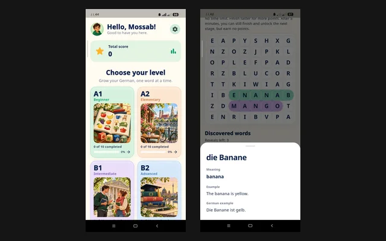
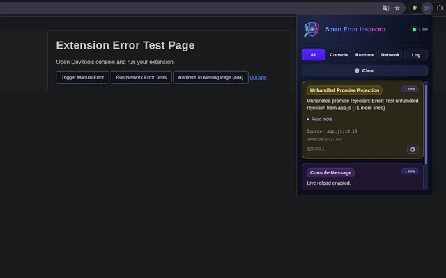
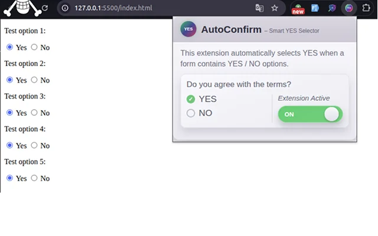
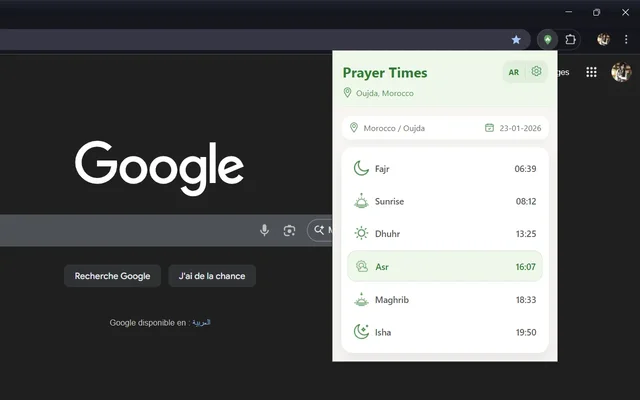

### `mossab@github ~ $ whoami`

<table>
  <tr>
    <td width="42%"></td>
    <td width="58%"></td>
  </tr>
</table>

### `mossab@github ~ $ ./contributions.sh`

## Hi, I'm Mossab

I build digital products and connect them with marketing.

<!-- Portfolio badge, add when the site is live:

-->

## Products

<table>
  <tr>
    <td width="50%" valign="top">
      
      <h3>Wortsuche</h3>
      
Learn German vocabulary with word search.

      
    </td>
    <td width="50%" valign="top">
      
      <h3>Smart Error Inspector</h3>
      
Inspect browser errors with more context.

      
    </td>
  </tr>
  <tr>
    <td width="50%" valign="top">
      
      <h3>Auto Radio Button</h3>
      
Select repetitive YES/NO form options in one click.

      
    </td>
    <td width="50%" valign="top">
      
      <h3>Prayer Timer</h3>
      
Prayer times with city selection and notifications.

      
    </td>
  </tr>
</table>

## Skills

**Marketing** 

**Product** 

**Automation** 

## Stats

