### `mossab@github ~ $ whoami`

### `mossab@github ~ $ ls ./stack`

<table>
  <tr><td><code>languages</code></td><td></td></tr>
  <tr><td><code>frontend</code></td><td></td></tr>
  <tr><td><code>mobile</code></td><td></td></tr>
  <tr><td><code>backend</code></td><td></td></tr>
  <tr><td><code>databases</code></td><td></td></tr>
  <tr><td><code>automation</code></td><td> </td></tr>
  <tr><td><code>ai-tools</code></td><td>   </td></tr>
  <tr><td><code>devops</code></td><td></td></tr>
</table>

### `mossab@github ~ $ ./contributions.sh`

